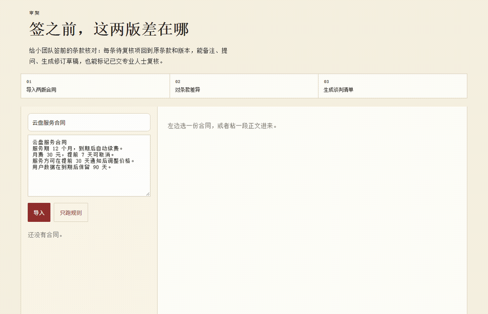
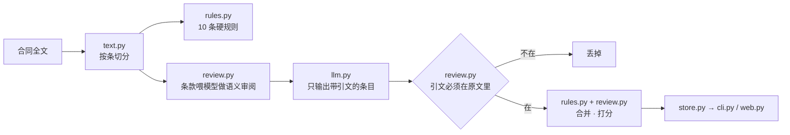

# Shenqi · Contract Risk Review

[](https://github.com/wushiyi105-jpg/shenqi/actions) []() [](./LICENSE) [](https://codecov.io/gh/wushiyi105-jpg/shenqi)

[](https://github.com/wushiyi105-jpg/shenqi/actions/workflows/test.yml)

Drop a contract in, get a risk list back: which clauses bite, where in the original they sit, and how to rewrite them. The score is out of 100, and the deduction rules are hard-coded rather than left to the model's mood.

The eighth thing I built. I built it because I once signed a contract with "automatic renewal" — at the time I only saw "renews automatically for one year on expiry", thought nothing of it, and only later realised I had never noticed it did not say how to cancel.



## Why rules plus a model, two passes

I first wanted to hand everything to the model. Trying it surfaced two things:

One, the model misses. A veto-level sentence like "no cap on compensation" reads smoothly to it, and it will happily wave it through with "overall risk is manageable". Two, the model drifts — especially when you ask "is there a problem with this contract", it tends to oblige you and dig up plausible-sounding points.

So I split it:

- **Rules handle "is it there"**: automatic renewal with no exit, unilateral changes, unlimited liability, full prepayment, 30% penalty, no termination clause, no dispute clause… these can be judged by regex and counting, cost nothing, and are not missed.
- **The model handles "does it feel right"**: is the availability promise an empty phrase, is the penalty one-sided, are data ownership and export written down. These need reading for meaning.

Rules run first and tell the model what has already been found, so it does not repeat them — it only searches the blind spots.

## Quotations must really be in the original

This one is hard. Every risk the model reports must carry a 20–60 character quotation from the original, and the program does a substring match against the contract (ignoring whitespace and punctuation). If it is not found, the item is dropped with no chance to argue, and the report carries one line: "模型给了 N 条引不出原文的风险，已丢弃".

Version one was loose: pass if the first 12 characters matched. Turned out 12 characters often ran into words the model itself added, and matching failed. Cut to the first 10, and it is stable.

## Data flow

How one piece of data moves between the modules:



## Quick start

```bash
git clone https://github.com/wushiyi105-jpg/shenqi.git
cd shenqi
cp .env.example .env        # Windows: copy .env.example .env
# open .env and fill in the key (DeepSeek and Zhipu both work, see below)
```

Import the two sample contracts and run one:

```bash
python -m shenqi add samples/云盘服务合同-坑版.txt samples/云盘服务合同-改后版.txt
python -m shenqi review 1 --rules-only      # costs nothing, rules only
python -m shenqi review 1                   # rules + model
```

The first one comes out like this:

```
=== 合同 [1] 云盘服务合同-坑版 · 8 分 · 别签，先改 ===
高 5 · 中 2 · 低 2 · 缺 3 项必备条款（规则 9 条 / 模型 0 条）
缺的必备条款：争议解决、解除或终止、知识产权归属

[高] 1. 自动续约没写退出方式（第三条）
   原文：合同期满后自动续期一年，除非一方提出异议。
   为什么：只写了会自动续，没写提前几天、用什么方式取消。
   怎么改：到期前 N 日可书面通知不续约，未通知视为续约一期；并写明取消入口。
```

The second (the revised one) with rules only scores 100. Same rules, one revision apart.

Start the Web UI:

```bash
python -m shenqi serve          # http://127.0.0.1:8768
```

Paste a contract on the left, the list appears on the right, and "只跑规则" shows something without spending a token.

## Command reference

| Command | What it does |
| --- | --- |
| `python -m shenqi add <文件...>` | Import contracts (txt / md); identical content is not duplicated |
| `python -m shenqi list` | Contract list with the latest score |
| `python -m shenqi review 1` | Full review (rules + model) |
| `python -m shenqi review 1 --rules-only` | Rules only, offline, free |
| `python -m shenqi review 1 --json` | Structured output for other scripts |
| `python -m shenqi review 1 --out 报告.md` | Write a markdown report |
| `python -m shenqi review 1 --side 乙方` | Review from the service provider's side instead |
| `python -m shenqi show 1` | Original, clause split, score history |
| `python -m shenqi rm 1` | Delete |
| `python -m shenqi stats` | Contract count, review count, average score |
| `python -m shenqi serve --port 8768` | Start the Web UI |

## The rule list

`rules.py` currently holds 10, each returning an original fragment and a replacement sentence you can paste in:

| Rule | When it fires | Level |
| --- | --- | --- |
| Auto-renewal without exit | Has "自动续期" but not how many days ahead or how to cancel | High |
| Unilateral change allowed | One party may change content, specs or price by itself | High |
| No liability cap | 「一切损失」「全额赔偿」「不设上限」 | High |
| Penalty too high | penalty ratio ≥30%, or ≥0.5% per day | High |
| No termination clause | nowhere in the text: 「解除 / 终止 / 解约」 | High |
| Full prepayment | pay in one go, work starts on payment | Medium |
| No dispute resolution | nowhere in the text: 「仲裁 / 诉讼 / 管辖」 | Medium |
| Amount without tax statement | has an amount, never mentions tax or invoice | Low |
| No effective date | no date and no effective condition | Low |
| Jurisdiction at the other side | agreed court is the counterparty's location | Low |

Beyond the 10 there is a required-clause check (price, term, delivery, breach, dispute, termination, confidentiality, IP) that lists whatever is missing.

## Two contracts, two scores, one revision

The two in `samples/` were not dashed off. The "trap" version is assembled from the most common real traps: auto-renewal without exit, unilateral repricing, all losses compensated in full with no cap, 30% penalty plus 1% per day, no termination clause, no jurisdiction, no IP ownership.

It scores 8. Then I revised it clause by clause into `云盘服务合同-改后版.txt`: added 99.5% availability, instalments, renewal 30 days' notice and auto-renewal switchable off, unilateral changes need 30 days' notice and allow exit without liability, liability capped, penalty 0.005% per day capped at 10%, plus limitation of liability, termination, data ownership and dispute resolution.

Same code: the revised version scores 100 on rules alone, not one high item.

**But with the model added, the same revised version scores only 56.** The model found 6 semantic risks that rules cannot see:

- Clause 7 caps the provider's total liability at 36,000 yuan, and clause 8 says "if data is unrecoverable because the client had no backup, the provider bears no responsibility". Stacked, almost all data-security risk lands on the client.
- Clause 1's 99.5% availability promise is remedied only by extending the service term, with no financial compensation.
- Clause 2's final 30% instalment is due 30 days before the term ends — you pay in full before you finish using it.

That surprised me at first, then felt right: rules verify "is what should be written there written", the model looks at "now that it is written, is it good for me". The two scores are not fighting, they answer two different questions. So both the page and the CLI report them separately: rules N items, model M items, you decide.

**Three real bugs fixed along the way:**

1. **One clause reported three times.** Clause 5's "一切损失……全额赔偿，不设上限" was hit by three regexes at once, and the first report listed the same sentence three times, looking like triple the risk. Added `_dedup`: one clause, one defect, keep only the longest evidence. The trap version went from 11 risks to 9.

2. **Which side you stand on, the rules did not know.** The revised version says "由甲方所在地人民法院管辖" — good for the client — and version one still reported "jurisdiction at the other side", because it did not know who "we" are. Added `--side`, defaulting to the client (the payer); the same sentence now only fires when viewed from the provider's side.

3. **The model's budget was eaten by reasoning.** After switching to glm-4.6, the response was three characters — ` ``` ` — with `finish_reason` = `length`, 2998 of 3000 tokens spent on reasoning. The old fallback only handled "body completely empty" and did not recognise "only a stub left", so it failed all the way down. Changed to "finish_reason=length and body under 200 characters" also retries with a doubled budget, capped at 8000. Same problem and same fix on deepseek-flash.

## Layout

```
shenqi/
├── shenqi/
│   ├── text.py     clause splitting, amount/date/ratio/day extraction
│   ├── rules.py    10 hard rules + required-clause check + scoring
│   ├── review.py   call the model, verify quotations, merge and dedupe
│   ├── store.py    SQLite: contracts, review results, score history
│   ├── llm.py      OpenAI-compatible client (urllib only)
│   ├── cli.py      command line
│   └── web.py      http.server page + JSON endpoints
├── samples/        two contrasting contracts (trap / revised)
├── tests/          86 offline unit tests
├── scripts/        usage GIF generation, model availability probe (dev only)
└── assets/demo.gif
```

## Tests

```bash
python -m unittest discover -s tests -v
```

86 cases, all offline: no network, no tokens. Covers clause splitting (including one-clause-per-line, table-of-contents shells, Chinese numbering), amount and day extraction, positive and negative cases for all 10 rules, quotation verification (real kept, invented dropped, prefix relaxation), model failure fallbacks, SQLite CRUD and history, every CLI subcommand, and the five Web endpoints.

CI runs Python 3.10–3.13, see the badge above.

## Switching models

Three `.env` variables, any OpenAI-style endpoint works:

```bash
# Zhipu (glm-4.6, verified working; paid channel)
LLM_BASE_URL=https://open.bigmodel.cn/api/paas/v4
LLM_MODEL=glm-4.6

# DeepSeek
LLM_BASE_URL=https://api.deepseek.com
LLM_MODEL=deepseek-flash
```

Both are reasoning models and only emit JSON with a generous budget; the doubled retry in the code exists for them.

## Things I got wrong

**A one-clause-per-line contract is the easiest to lose.** When I first split clauses I treated the text after the number as a heading and whatever followed the newline as the body. For a layout like "第一条 本合同自签署之日起生效", the body comes out empty. That layout is extremely common in real contracts.

**Do not hard-code Chinese numerals to digits.** The "三十" in "提前三十个工作日" has to become 30 before you can compare. I wrote a parser that goes up to hundreds — enough, and not worth a third-party library for one number.

**A broken rule function must not sink the whole review.** Every rule in `run_rules` has its own try; one blowing up is skipped. In contract review, one missed item beats a report that fails to render.

**Always treat the model's JSON as untrusted input.** A level written as "乱写" is treated as medium; a quotation not found is dropped; a non-object response is a failure. Whatever it says passes through the program first.

## Author

shiyi · wushiyi105@gmail.com · [@wushiyi105-jpg](https://github.com/wushiyi105-jpg)

## License

MIT
