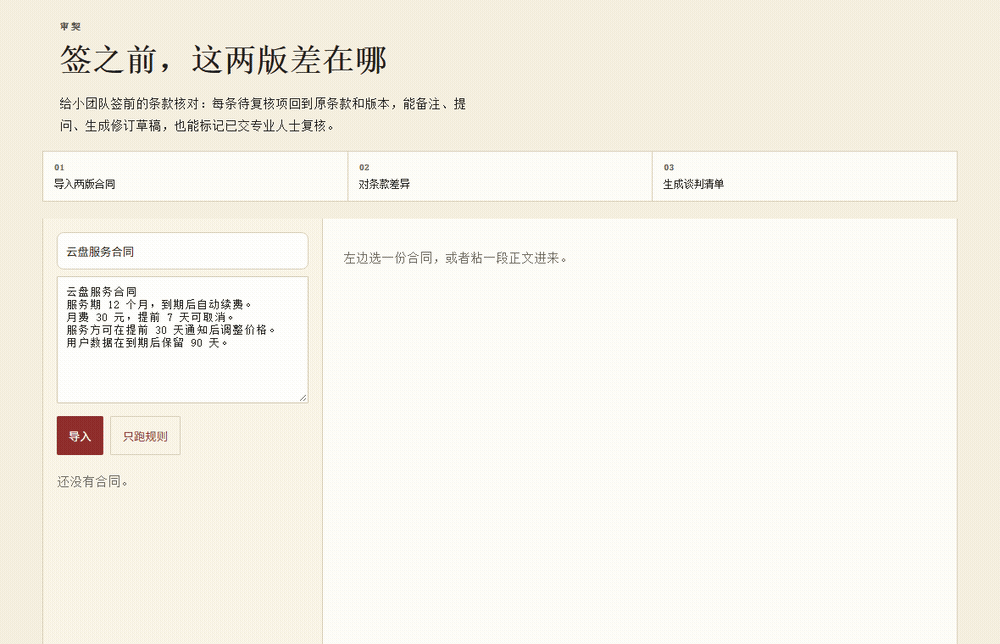
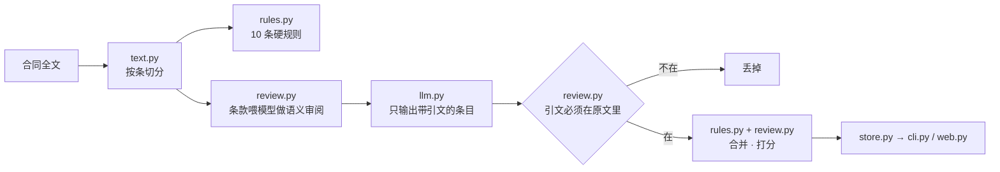

# 审契 · Shenqi

[](https://github.com/wushiyi105-jpg/shenqi/actions) []() [](./LICENSE) [](https://codecov.io/gh/wushiyi105-jpg/shenqi)

[](https://github.com/wushiyi105-jpg/shenqi/actions/workflows/test.yml)

把一份合同丢进去，回来一张风险清单：哪几条会咬人、原文在哪一句、该怎么改。分数是 100 分制，扣分规则写死在代码里，不由模型心情决定。

我做的第 8 个东西。做它是因为我自己签过一份「自动续期」的合同——当时只看到"到期自动续一年"，觉得没什么，后来才发现自己根本没注意到它没说怎么取消。



[打开这次本地实跑的结果图](assets/result.png) — 上面 GIF 与这张图都来自 2026-11-28 的新版界面，不是示意图。

## 为什么要规则 + 模型两道

一开始我想全交给模型。试了才发现两件事：

一是模型会漏。合同里「不设赔偿上限」这种一票否决型的话，它读得很顺，很容易一句"整体风险可控"就带过去。二是模型会飘，尤其当你问它"这份合同有问题吗"，它倾向于配合你，找出些似是而非的点。

所以拆成两半：

- **规则管「有没有」**：自动续约没写退出方式、单方变更、无限责任、全额预付、30% 违约金、没有解除条款、没有争议解决条款……这些用正则和计数就能判，不花一分钱，也不会漏。
- **模型管「对不对味」**：可用性指标是不是一句空话、违约金是否只罚一方、数据归属和导出有没有写。这些得读懂意思。

规则先跑，把已经发现的问题告诉模型，让它别重复报——它只在规则的盲区里找。

## 引文必须真的在原文里

这一条是硬的。模型给的每条风险都要带一句 20–60 字的原文，程序拿这句去合同里做子串匹配（忽略空白和标点）。找不到，这条直接丢掉，不给它辩解的机会，报告里只写一行「模型给了 N 条引不出原文的风险，已丢弃」。

第一版我留得松：只要前 12 个字能对上就放行。结果发现 12 字经常正好跨到模型自己加的话上，匹配失败。改成前 10 个字，稳了。

## 数据流

一条数据在这几个模块之间怎么走：



## 快速开始

```bash
git clone https://github.com/wushiyi105-jpg/shenqi.git
cd shenqi
cp .env.example .env        # Windows: copy .env.example .env
# 打开 .env，填 key（DeepSeek 和智谱都能用，见文末）
```

导入两份样例合同，跑一遍：

```bash
python -m shenqi add samples/云盘服务合同-坑版.txt samples/云盘服务合同-改后版.txt
python -m shenqi review 1 --rules-only      # 不花钱，只跑规则
python -m shenqi review 1                   # 规则 + 模型
```

第一份跑出来是这样：

```
=== 合同 [1] 云盘服务合同-坑版 · 8 分 · 别签，先改 ===
高 5 · 中 2 · 低 2 · 缺 3 项必备条款（规则 9 条 / 模型 0 条）
缺的必备条款：争议解决、解除或终止、知识产权归属

[高] 1. 自动续约没写退出方式（第三条）
   原文：合同期满后自动续期一年，除非一方提出异议。
   为什么：只写了会自动续，没写提前几天、用什么方式取消。
   怎么改：到期前 N 日可书面通知不续约，未通知视为续约一期；并写明取消入口。
```

第二份（改过的）我只跑规则，是 100 分。同一套规则，中间只差了一次修订。

起 Web：

```bash
python -m shenqi serve          # http://127.0.0.1:8768
```

左边粘合同，右边出清单，点「只跑规则」不花 token 也能看。

Docker 运行(容器内用默认端口 8768):

```bash
docker build -t shenqi .
docker run -p 8768:8768 shenqi
```

## 🤔 为什么不用通用大模型直接问

通用模型读完合同也能列几条风险,但神启补的是它做不到的三件事:

1. **分数不由模型心情决定** —— 100 分制、扣分规则、必备条款检查全部写死在代码里,同一份合同跑两次分数一样;模型只补充规则没覆盖到的风险,补的每条也要有原文。
2. **引文必须真的在原文里** —— 每条风险都标原文那一句,程序回查不到就标出来;通用模型爱把「通常的条款」当成「你合同里的条款」。
3. **合同留在本地** —— 合同是最不该随便上传的文件之一;原文与审查结果存在本地 SQLite,调模型时只发当前这一份。
4. **结构化输出** —— 风险等级、条款位置、原文、为什么、怎么改是按条列出的,`--json` 能进表格;通用对话给一段总结,谈判时没法逐条对。

## 🎯 适用场景

- **签 SaaS 续费合同之前**:重点看自动续约、涨价、数据归属、终止条件,规则先把「没写怎么取消」这类缺口点出来。
- **对比改前改后两版**:坑版先跑一遍,对方改完再跑一遍,分数从 8 分到 100 分的差别在哪几条,一目了然。
- **发给同事一起看**:把风险清单导出来,谁负责谈哪一条写在旁边,不用在群里复述合同。

## 🗺 Roadmap

- **规则可配置**:把 9 条规则与必备条款做成配置文件,不同合同类型用不同规则集。
- **合同类型模板**:服务合同、租赁、劳动合同各一套检查项。
- **两版差异对比**:直接标出改后版新增、删除了哪些条款,而不只是重打分。
- **谈判话术**:每条高风险给一句可以直接发给对方的修改措辞。
- **报告导出**:风险清单导成 Markdown,带原文与建议。

## ❓ FAQ

**API key 从哪来?**
规则审查不需要 key;`review`(不带 `--rules-only`)才调模型。默认接智谱(`glm-4.6`),DeepSeek 也行,见 `.env.example`。

**数据存在哪,会上传吗?**
合同原文与审查结果在本地 SQLite;调模型时只发当前这一份合同,不发给别的服务留存。

**没有 key 能不能用?**
能,`--rules-only` 只跑规则:必备条款缺失、自动续约、单方解约这类硬问题照查,分数照算;没有模型补充的风险。

**怎么换模型?**
改 `LLM_BASE_URL`、`LLM_MODEL`、`LLM_API_KEY`;规则与分数不受影响。

**8 分是什么意思?**
是示例合同按规则扣出来的分,不是模型的语气。规则扣了哪些、缺了哪几项必备条款,报告里逐条列着。

## 命令参考

| 命令 | 作用 |
| --- | --- |
| `python -m shenqi add <文件...>` | 导入合同（txt / md），同内容重复导入不新建 |
| `python -m shenqi list` | 合同列表，带最近一次分数 |
| `python -m shenqi review 1` | 完整体检（规则 + 模型） |
| `python -m shenqi review 1 --rules-only` | 只跑规则，离线、不花钱 |
| `python -m shenqi review 1 --json` | 结构化输出，方便接别的脚本 |
| `python -m shenqi review 1 --out 报告.md` | 写一份 markdown 报告 |
| `python -m shenqi review 1 --side 乙方` | 换成替乙方（服务方）看 |
| `python -m shenqi show 1` | 原文、条款切分、历次分数 |
| `python -m shenqi rm 1` | 删掉 |
| `python -m shenqi stats` | 合同数、体检次数、平均分 |
| `python -m shenqi serve --port 8768` | 起 Web |

## 规则清单

`rules.py` 里现在有 10 条，每一条都会给出原文片段和一句可以直接替换进去的改法：

| 规则 | 什么时候报 | 级别 |
| --- | --- | --- |
| 自动续约没写退出 | 有「自动续期」但没写提前几天、怎么取消 | 高 |
| 允许单方变更 | 一方可自行改内容、规格、价格 | 高 |
| 赔偿无上限 | 「一切损失」「全额赔偿」「不设上限」 | 高 |
| 违约金过高 | 违约金比例 ≥30%，或按日 ≥0.5% | 高 |
| 没有解除条款 | 全文无「解除 / 终止 / 解约」 | 高 |
| 全额预付 | 一次性付清、款到开工 | 中 |
| 没有争议解决 | 全文无「仲裁 / 诉讼 / 管辖」 | 中 |
| 金额没说含税 | 有金额，但没提税和发票 | 低 |
| 没有生效日期 | 全文无日期，也无生效条件 | 低 |
| 管辖在对方所在地 | 约定对方所在地法院 | 低 |

除了这 10 条，还有一份必备条款体检（价款、期限、交付、违约、争议、解除、保密、知识产权），缺哪样列哪样。

## 两份合同，两个分数，一段改进

`samples/` 里那两份不是随手写的。坑版是按真实合同里最常见的几处坑拼出来的：自动续约不写退出、单方调价、一切损失全额赔偿不设上限、30% 违约金 + 每日 1%、没有解除条款、没有管辖、没有知识产权归属。

体检给 8 分。然后我拿它一处处改，改成了 `云盘服务合同-改后版.txt`：加了可用性 99.5%、分期付款、续约提前 30 日通知且可随时关掉自动续费、单方变更需提前 30 日通知且不同意可无责退出、赔偿封顶、违约金万分之五并封顶 10%、加了责任限制、解除、数据归属、争议解决。

同一套代码，改后版只跑规则 100 分，一条 high 都没有。

**但加上模型，同一份改后版只有 56 分。** 模型挑出 6 条语义风险，规则一条都看不见：

- 第七条把乙方总赔偿封顶在 36,000 元，第八条又写「甲方没备份导致的数据不可恢复，乙方不承担责任」。两条叠起来，数据安全的风险几乎全压在甲方身上。
- 第一条的可用性承诺（99.5%）违约后只是顺延服务期，没有任何经济补偿。
- 第二条最后一笔 30% 在服务期满前 30 日就要付完，等于还没用完就先付清。

这件事我一开始有点意外，后来觉得挺对：规则验的是「该写的有没有写上」，模型看的是「写上之后对我到底好不好」。两个分数不是打架，是在回答两个不同的问题。所以页面和 CLI 都把两边分开报：规则 N 条、模型 M 条，你自己看。

**过程中修掉的三个真 bug：**

1. **同一条款被报了三次。** 第五条那句「一切损失……全额赔偿，不设上限」被三条正则全命中了，第一版报告里同一句话列了三遍，看着像三倍风险。加了 `_dedup`：同一条款同一个毛病只留证据最长的一条。坑版的风险条数从 11 降到 9。

2. **站在哪一边看，规则不知道。** 改后版明明写的是「由甲方所在地人民法院管辖」，对甲方是好事，第一版照样报「管辖在对方所在地」——因为它不知道"我方"是谁。加了 `--side`，默认甲方（付款方），现在同一句话站在乙方看才报。

3. **模型的预算是被推理吃掉的。** 换到 glm-4.6 之后，返回的内容只有三个字符 ` ``` `，`finish_reason` 是 `length`，3000 个 token 里 2998 个花在 reasoning 上。原来的兜底只处理"正文完全为空"，这种"只剩个开头"的情况它不认，于是一路失败。改成「finish_reason=length 且正文短于 200 字」也翻倍重试，上限 8000，才稳。deepseek-flash 上同样的问题，同一个修法。

## 目录结构

```
shenqi/
├── shenqi/
│   ├── text.py     条款切分、金额/日期/比例/天数抽取
│   ├── rules.py    10 条硬规则 + 必备条款体检 + 打分
│   ├── review.py   调模型、核验引文、合并去重
│   ├── store.py    SQLite：合同、每次体检结果、历史分数
│   ├── llm.py      OpenAI 兼容客户端（零依赖 urllib）
│   ├── cli.py      命令行
│   └── web.py      http.server 页面 + JSON 接口
├── samples/        两份对照合同（坑版 / 改后版）
├── tests/          86 个离线单测
├── scripts/        生成示例 GIF、探测模型可用性（开发期用）
└── assets/demo.gif
```

## 测试

```bash
python -m unittest discover -s tests -v
```

86 个用例，全部离线：不联网、不花 token。覆盖了条款切分（含一条一行、目录页空壳、中文编号）、金额与天数抽取、10 条规则的正反例、引文核验（真引文保留、编造丢弃、前缀放宽）、模型失败兜底、SQLite 增删改查与历史、CLI 的每个子命令、Web 的五个接口。

CI 跑 Python 3.10–3.13，见上方徽章。

## 换模型

`.env` 里三个变量就够，任何 OpenAI 风格的接口都能接：

```bash
# 智谱（glm-4.6，实测可用；付费通道）
LLM_BASE_URL=https://open.bigmodel.cn/api/paas/v4
LLM_MODEL=glm-4.6

# DeepSeek
LLM_BASE_URL=https://api.deepseek.com
LLM_MODEL=deepseek-flash
```

两家都是推理型，预算给足才吐 JSON，代码里的翻倍重试就是为它们准备的。

## 几个踩过的坑

**「一条一行」的合同最容易被切丢。** 刚开始切条款时，我把编号后面那段当标题、把换行之后当正文。碰上「第一条 本合同自签署之日起生效」这种一条一行的写法，正文就是空的。真实合同里这种写法非常常见。

**中文字数转数字别硬写。** 「提前三十个工作日」里的"三十"要转成 30 才能比大小。写了个只认到百位的解析，够用，也不至于为了一个数字去装第三方库。

**规则函数写错不该拖垮整次体检。** `run_rules` 里每条规则各自 try，一条炸了跳过。合同审阅这种活，少报一条比整份报告报不出来强。

**模型的 JSON 永远当成不可信输入。** 级别写了「乱写」的，按 medium 处理；引文找不到的，丢弃；返回的不是对象，当失败。它说什么都得先过一遍程序。

## 作者

shiyi · wushiyi105@gmail.com · [@wushiyi105-jpg](https://github.com/wushiyi105-jpg)

## License

MIT
